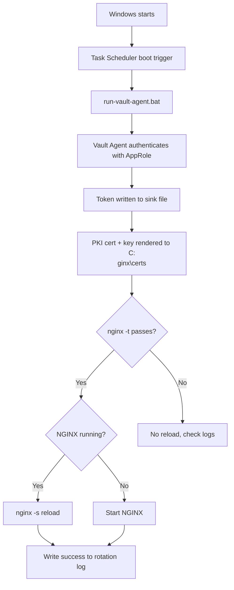

# txc26-LAB-3042

**Implementation & Operations Guide** — HashiCorp Vault Agent on Windows with NGINX TLS certificate auto-rotation.


> [!WARNING]
> This is a **lab implementation** (5-minute certificate TTL, HTTP Vault endpoint, `curl -k` testing). Read [Prerequisites and security notes](#4-prerequisites-and-security-notes) and the [Readiness checklist](#11-readiness-checklist) before using it in production.

## Step 1: Mark your attendance

Before you start the lab, register your presence as a student:

1. Open **https://ibm.biz/~BwXw980gj**
2. Log in.
3. Enter the access code:

   ```
   techxLAB-3042-5a07
   ```

---

## Table of Contents

**Lab**

1. [Purpose and scope](#1-purpose-and-scope)
2. [High-level flow](#2-high-level-flow)
3. [Lab environment and paths](#3-lab-environment-and-paths)
4. [Prerequisites and security notes](#4-prerequisites-and-security-notes)
5. [Installation and directory preparation](#5-installation-and-directory-preparation)
6. [Vault Agent configuration](#6-vault-agent-configuration)
7. [Agent launcher batch file](#7-agent-launcher-batch-file)

**[End of lab](#end-of-lab)**

**Optional: try at home**

8. [Configure Windows Task Scheduler](#8-configure-windows-task-scheduler)
9. [Validation and operational tests](#9-validation-and-operational-tests)
10. [Troubleshooting history and corrective actions](#10-troubleshooting-history-and-corrective-actions)
11. [Readiness checklist](#11-readiness-checklist)
12. [Evidence screenshots](#12-evidence-screenshots)

---

## 1. Purpose and scope

This guide records the Windows lab implementation used to automatically obtain TLS certificate material from Vault PKI, write the certificate and private key to the NGINX certificate directory, validate the NGINX configuration, and reload NGINX (or start it if it is not running). Windows Task Scheduler launches Vault Agent at system startup so the workflow can recover after a reboot.

The lab used Windows 10 Pro 64-bit, Vault CLI/Agent v2.2.0, NGINX 1.30.0, and a certificate TTL of 5 minutes. Replace lab values with approved production values before production rollout.

## 2. High-level flow



1. Windows starts and Task Scheduler triggers the task at system startup.
2. The task runs `C:\Vault\run-vault-agent.bat`.
3. Vault Agent reads the AppRole Role ID and Secret ID files and authenticates to the configured Vault address.
4. The agent writes its token to the sink file and renders the PKI certificate and private key into `C:\nginx\certs\`.
5. The certificate template command runs `nginx.exe -t`.
6. If the configuration test succeeds, the command reloads NGINX when it is running; otherwise it starts NGINX.
7. The rotation log records a success line after the configuration test passes and the reload/start command is attempted.
8. The operator verifies the live HTTPS endpoint, certificate expiry/thumbprint, file timestamps, and logs.

## 3. Lab environment and paths

| Item | Lab value |
|---|---|
| Operating system | Windows 10 Pro, version 2009, 64-bit |
| Vault binary | `C:\Vault\vault.exe` |
| Vault version | v2.2.0 |
| NGINX directory | `C:\nginx` |
| Certificate directory | `C:\nginx\certs` |
| Agent configuration | `C:\Vault\config\vault-agent.hcl` |
| Agent launcher | `C:\Vault\run-vault-agent.bat` |
| Agent log | `C:\Vault\logs\vault-agent.log` |
| Rotation log | `C:\Vault\logs\certificate-rotation.log` |
| Credential files | `C:\Vault\credentials\role_id` and `secret_id` |
| Rendered certificate/key | `C:\nginx\certs\nginx.crt` and `nginx.key` |
| Scheduled task | `Vault Agent - Certificate Rotation` |
| Vault address | `<VAULT_ADDR>` (e.g. `https://vault.example.com:8200`) |
| PKI role / common name | PKI role `nginx-app`; CN `app.example.com` |
| Lab certificate TTL | `5m` (testing only) |

## 4. Prerequisites and security notes

- A supported Windows Server version with approved administrative access.
- Network reachability from the Windows host to the Vault API endpoint, with trusted TLS validation for production.
- A Vault AppRole with only the policy permissions required to issue certificates from the approved PKI role.
- A PKI role configured for the intended DNS name(s), allowed domains, key type, and maximum TTL.
- NGINX installed, with its HTTPS server block using `C:/nginx/certs/nginx.crt` and `C:/nginx/certs/nginx.key`.
- Task Scheduler configured to run at system startup with the required local permissions.
- Role ID/Secret ID files, token sink, private key, configuration, and logs protected with restrictive ACLs.

> [!CAUTION]
> Never commit real Role IDs, Secret IDs, Vault tokens, or private keys to this repository or include them in screenshots.

- The lab used an HTTP Vault address. Use HTTPS with certificate validation in production unless an approved architecture says otherwise.
- Use an approved certificate TTL and renewal window. A 5-minute TTL is for accelerated lab testing only.

## 5. Installation and directory preparation

### 5.1 Create the directories

```powershell
New-Item -ItemType Directory -Force -Path C:\Vault
New-Item -ItemType Directory -Force -Path `
  "C:\Vault\config", `
  "C:\Vault\credentials", `
  "C:\Vault\logs", `
  "C:\Vault\rendered"
```

`-Force` makes directory creation repeatable when a directory already exists.

### 5.2 Configure Vault AppRole credentials

Vault Agent needs the Role ID and Secret ID to authenticate. Creating the credentials directory does not generate these values.

**Create the credential files**

```powershell
New-Item -ItemType File -Force -Path "C:\Vault\credentials\role_id"
New-Item -ItemType File -Force -Path "C:\Vault\credentials\secret_id"
```

**Populate the files**

```powershell
notepad C:\Vault\credentials\role_id     # paste <YOUR_ROLE_ID>
notepad C:\Vault\credentials\secret_id   # paste <YOUR_SECRET_ID>
```

Get these from Vault:

```bash
vault read auth/approle/role/nginx-app/role-id
vault write -f auth/approle/role/nginx-app/secret-id
```

**Verify the files**

```powershell
Get-Item C:\Vault\credentials\role_id, C:\Vault\credentials\secret_id |
  Select-Object FullName, Length
```

Confirm both files exist and contain their expected values before starting Vault Agent. Restrict access to them with Windows ACLs; the Secret ID is sensitive authentication material.

### 5.3 Install Vault CLI/Agent

```powershell
# Verify the approved version and checksum before using in a client environment.
Invoke-WebRequest `
  -Uri "https://releases.hashicorp.com/vault/2.2.0/vault_2.2.0_windows_amd64.zip" `
  -OutFile "C:\Vault\vault_2.2.0_windows_amd64.zip"

Expand-Archive `
  -Path "C:\Vault\vault_2.2.0_windows_amd64.zip" `
  -DestinationPath "C:\Vault" -Force

C:\Vault\vault.exe version
```

### 5.4 Install NGINX

```powershell
Invoke-WebRequest `
  -Uri "https://nginx.org/download/nginx-1.30.0.zip" `
  -OutFile "$env:USERPROFILE\Downloads\nginx.zip"

Expand-Archive `
  -Path "$env:USERPROFILE\Downloads\nginx.zip" `
  -DestinationPath "C:\" -Force

Rename-Item "C:\nginx-1.30.0" "nginx"
Set-Location C:\nginx
.\nginx.exe
```

Confirm the NGINX package source, version, and integrity according to your software supply-chain policy.

### 5.5 Configure NGINX for HTTPS

Create the certificate directory (PowerShell as Administrator):

```powershell
New-Item -ItemType Directory -Force -Path "C:\nginx\certs"
```

Vault Agent writes the certificate chain to `C:\nginx\certs\nginx.crt` and the private key to `C:\nginx\certs\nginx.key`. Make sure the NGINX process identity can read both files, and restrict access to the private key as tightly as possible.

Edit `C:\nginx\conf\nginx.conf`:

```powershell
notepad C:\nginx\conf\nginx.conf
```

For a fresh lab install, replace the file with:

```nginx
worker_processes 1;

events {
    worker_connections 1024;
}

http {
    include       mime.types;
    default_type  application/octet-stream;
    sendfile      on;
    keepalive_timeout 65;

    server {
        listen 443 ssl;
        server_name localhost;

        ssl_certificate     C:/nginx/certs/nginx.crt;
        ssl_certificate_key C:/nginx/certs/nginx.key;

        location / {
            root  html;
            index index.html;
        }
    }
}
```

On an existing install, merge the `server` block into the existing `http { ... }` block instead. Don't create a second top-level `http` block or a duplicate listener on 443.

> [!IMPORTANT]
> This assumes the certificate covers `app.example.com` and that `nginx.crt` contains the server certificate plus any required issuing CA chain. Clients must trust the issuing CA.

**Validate and reload NGINX**

```powershell
& "C:\nginx\nginx.exe" -p C:\nginx -t
curl.exe -k -I --max-time 10 https://localhost/
Get-Content C:\nginx\logs\error.log -Tail 30
```

Expected: `nginx -t` reports the syntax is ok and the test is successful, and the HTTPS request returns a response (the lab returned `HTTP 200 OK`). `-k` skips certificate validation and is for lab connectivity testing only. Log paths depend on the `error_log` / `access_log` directives in `nginx.conf`.

## 6. Vault Agent configuration

Create `C:\Vault\config\vault-agent.hcl` with AppRole auto-auth, a file token sink, separate templates for the key and certificate, and a PowerShell command attached to the certificate template.

> [!WARNING]
> **Lab pattern only.** The two templates use separate `secret "pki/issue/nginx-app"` lookups, which can issue **different key pairs**. Before production, change this so the certificate and private key come from the same issuance response, and verify the public/private keys match on every rotation.

```powershell
notepad C:\Vault\config\vault-agent.hcl
```

```hcl
pid_file  = "C:/Vault/logs/vault-agent.pid"
log_file  = "C:/Vault/logs/vault-agent.log"
log_level = "info"

vault {
  address = "<VAULT_ADDR>"   # e.g. https://vault.example.com:8200
  # Configure trusted CA validation for the Vault TLS certificate.
}

auto_auth {
  method "approle" {
    mount_path = "auth/approle"
    config = {
      role_id_file_path                   = "C:/Vault/credentials/role_id"
      secret_id_file_path                 = "C:/Vault/credentials/secret_id"
      remove_secret_id_file_after_reading = false
    }
  }

  sink "file" {
    config = {
      path = "C:/Vault/credentials/token"
    }
  }
}

# LAB PATTERN ONLY: separate lookups can produce a mismatched key/certificate.
template {
  destination = "C:/nginx/certs/nginx.key"
  perms       = "0600"
  contents    = <<EOH
{{- with secret "pki/issue/nginx-app" "common_name=app.example.com" "ttl=5m" -}}
{{ .Data.private_key }}
{{- end -}}
EOH
}

template {
  destination = "C:/nginx/certs/nginx.crt"
  perms       = "0644"

  command = [
    "powershell.exe", "-NoProfile", "-Command",
    "& C:\\nginx\\nginx.exe -p C:\\nginx -t; if ($LASTEXITCODE -eq 0) { if (Get-Process nginx -ErrorAction SilentlyContinue) { & C:\\nginx\\nginx.exe -p C:\\nginx -s reload } else { Start-Process C:\\nginx\\nginx.exe -ArgumentList '-p C:\\nginx' -WorkingDirectory C:\\nginx }; Add-Content C:\\Vault\\logs\\certificate-rotation.log \"CERTIFICATE ROTATION SUCCESS - $(Get-Date)\" }"
  ]

  contents = <<EOH
{{- with secret "pki/issue/nginx-app" "common_name=app.example.com" "ttl=5m" -}}
{{ .Data.certificate }}
{{ .Data.issuing_ca }}
{{- end -}}
EOH
}
```

**Test the connection and run the agent manually**

```powershell
Test-NetConnection <VAULT_HOST> -Port 8200
C:\Vault\vault.exe agent -config="C:\Vault\config\vault-agent.hcl"
```

Then open `https://localhost/` in a browser.

Replace the example Vault address and lab TTL with approved values, and validate the HCL syntax against your installed Vault Agent version.

## 7. Agent launcher batch file

```powershell
notepad C:\Vault\run-vault-agent.bat
```

```bat
@echo off
setlocal
cd /d C:\Vault
"C:\Vault\vault.exe" agent -config="C:\Vault\config\vault-agent.hcl"
echo Vault Agent exited with code %ERRORLEVEL% >> "C:\Vault\logs\vault-agent-launch.log"
endlocal
```

Check that everything is in place (all three should return `True`), then run it:

```powershell
Test-Path C:\Vault\vault.exe
Test-Path C:\Vault\config\vault-agent.hcl
Test-Path C:\Vault\run-vault-agent.bat

& "C:\Vault\run-vault-agent.bat"
```

The batch file runs Vault Agent in the foreground and appends the exit code if the agent stops. Configure a task failure/restart policy where required.

---

## End of lab

🎉 **You've completed the lab.** Vault Agent is now issuing certificates to NGINX and rotating them automatically.

The sections below are **optional** for you to try at home: running the agent at startup with Task Scheduler, deeper validation tests, troubleshooting notes, and a production-readiness checklist.

---

## Optional: try at home

## 8. Configure Windows Task Scheduler

Create a task named `Vault Agent - Certificate Rotation`:

| Setting | Value |
|---|---|
| Trigger | At system startup (boot trigger) |
| Action | Start a program: `C:\Vault\run-vault-agent.bat` |
| Security | Run whether user is logged on or not |
| Account | Least-privileged identity with required access (lab used `SYSTEM`) |
| Settings | Enabled; restart on failure; execution policy suitable for your environment |

Confirm permissions for the certificate files, logs, Vault binary/configuration, and NGINX directory.

```powershell
# Verify task state and trigger type
Get-ScheduledTask -TaskName "Vault Agent - Certificate Rotation" |
  Select-Object TaskName, State

(Get-ScheduledTask -TaskName "Vault Agent - Certificate Rotation").Triggers |
  ForEach-Object { $_.CimClass.CimClassName }

# Expected trigger type: MSFT_TaskBootTrigger
```

## 9. Validation and operational tests

### 9.1 Task, processes, and NGINX configuration

```powershell
Get-ScheduledTask -TaskName "Vault Agent - Certificate Rotation" |
  Select-Object TaskName, State

Get-Process vault, nginx -ErrorAction SilentlyContinue |
  Select-Object ProcessName, Id

C:\nginx\nginx.exe -p C:\nginx -t
```

Expected: the task is `Running`, Vault and NGINX processes are present, and NGINX reports the syntax is ok.

### 9.2 HTTPS

```powershell
curl.exe -k -I https://localhost/
```

Lab result: `HTTP/1.1 200 OK`. In production, validate trust and hostname without disabling certificate validation.

### 9.3 Rotation logs and file timestamps

```powershell
Get-Content C:\Vault\logs\certificate-rotation.log -Tail 10
Get-Content C:\Vault\logs\vault-agent.log -Tail 30
Get-Item C:\nginx\certs\nginx.crt, C:\nginx\certs\nginx.key |
  Select-Object Name, LastWriteTime, Length
```

The lab logs showed successful authentication and rendering of both files, followed by a rotation log entry. This confirms the template command ran; on its own it does not prove the reload succeeded.

### 9.4 Compare the live certificate with the certificate on disk

```powershell
$diskCert = [System.Security.Cryptography.X509Certificates.X509Certificate2]::new(
    "C:\nginx\certs\nginx.crt"
)
$req = [System.Net.HttpWebRequest]::Create("https://localhost/")
$req.ServerCertificateValidationCallback = { $true }

try {
    $response = $req.GetResponse()
    $liveCert = [System.Security.Cryptography.X509Certificates.X509Certificate2]::new(
        $req.ServicePoint.Certificate
    )
    $response.Close()

    [PSCustomObject]@{
        DiskThumbprint   = $diskCert.Thumbprint
        LiveThumbprint   = $liveCert.Thumbprint
        CertificateMatch = ($diskCert.Thumbprint -eq $liveCert.Thumbprint)
    } | Format-List
}
catch {
    Write-Host "HTTPS verification failed: $($_.Exception.Message)"
}
```

Lab result: disk and live thumbprints matched (`CertificateMatch : True`). The script disables certificate validation for this comparison only, so it is not a trust-chain or hostname test.

### 9.5 Reboot recovery test

1. Save work and restart Windows normally.
2. After sign-in, verify the scheduled task is `Running` and the Vault/NGINX processes exist.
3. Check the agent log for successful AppRole authentication and template rendering after boot.
4. Run the NGINX configuration test and HTTPS request.
5. Verify the certificate/key pair, live certificate thumbprint, and reload behavior.
6. Wait through several rotations and confirm there is no mismatch, expiry gap, or NGINX downtime.

## 10. Troubleshooting history and corrective actions

| Observed issue | Likely cause / evidence | Action / lesson |
|---|---|---|
| Vault Agent log permission denied | Agent identity could not write under `C:\Vault\logs`. | Grant the task identity only the required filesystem permissions; retest under the same identity Task Scheduler uses. |
| NGINX private-key mismatch | NGINX reported `SSL_CTX_use_PrivateKey` failure; separate PKI issue lookups can return different key pairs. | Source the certificate and private key from one issuance response. Validate key/cert matching before reload. |
| NGINX reload attempted while not running | A reload can't signal a process that isn't running. | Use a guarded process check and start NGINX if absent. Check start/reload exit status and the NGINX error log. |
| `writeToFile` wrong number of args | Agent reported `wrong number of args for writeToFile: want at least 4 got 3`. | Remove or fix the incorrectly called function; validate template syntax against the deployed Agent version. |
| Success log could overstate success | The command writes success after the config test and command attempt, without checking the reload/start exit code. | Log separate CONFIG_TEST, RELOAD/START, and END-TO-END statuses, and log success only when every step succeeds. |

## 11. Readiness checklist

- [ ] Use HTTPS to Vault with CA validation; no cleartext Vault API traffic.
- [ ] AppRole policy is least privilege, and credentials are protected by ACLs or an approved secret delivery method.
- [ ] Certificate and key come from a single issuance response and are confirmed to match before deploying.
- [ ] Production TTL is approved and the renewal cadence leaves enough safety margin.
- [ ] Reload/start script fails closed: checks every exit code, logs errors, and never logs success on failure.
- [ ] Tested multiple consecutive rotations, expiry, Vault outage, network interruption, and reboot recovery.
- [ ] Task Scheduler restart-on-failure, monitoring/alerting, log retention, and permissions configured.
- [ ] Live certificate chain and hostname validated against a trusted CA, not only `curl -k`.
- [ ] Rollback procedure and certificate backup/restore documented without exposing private keys.
- [ ] Windows, Vault/Agent and NGINX versions, PKI role settings, DNS names, and firewall rules confirmed.

## 12. Evidence screenshots

Screenshots from the lab build. Replace or supplement them with full-resolution screenshots from the final Windows Server build where formal evidence is required.

<details>
<summary><b>Show screenshots</b></summary>

#### Credential files and Vault download


#### Windows environment and Vault download


#### Vault installation


#### NGINX installation


#### NGINX process verification


#### NGINX certificate directory


#### Additional setup commands


#### OS information


#### Certificate rotation status


#### Vault Agent log


#### Application-side verification


</details>
